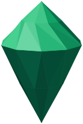
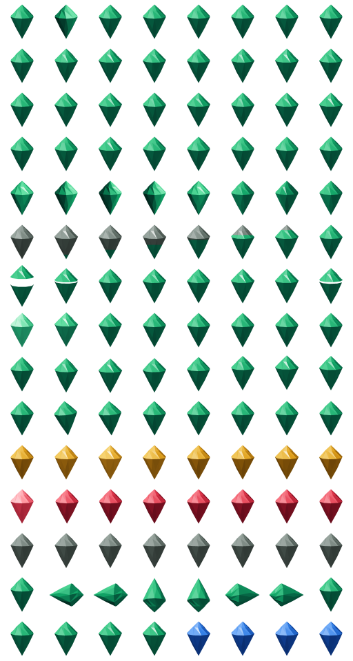

# The simee mark

simee's mark is a cut emerald: two pyramids joined at a ten-sided girdle, with a second, twisted
ring of facets on each pyramid. It is 1.5 times taller than it is wide and has 60 facets. It is
never given eyes, a face or anything else that makes it a character.

One description of the stone draws it everywhere. `crates/sim-core/src/mark/` holds its shape
(`Cut::SIMEE`), its light and framing (`Style::MARK`, `Pose::LIGHT`, `Pose::GLOW`), its colours
(`Tone`) and its motion states (`Motion`). The desktop window projects it live into Rune fills,
and `scripts/brand.sh` writes every file in `assets/brand/` from it. To change the mark, change it
there and run `scripts/brand.sh`. A `sim-core` test fails while the committed SVGs no longer match
the code.

## The cut

The cutter's terms name the parts: the **crown** is the upper pyramid, the **girdle** the widest
ring where the two meet, the **pavilion** the lower pyramid, a **table** a flat top and a
**culet** a flat tip.

| Field | simee | What it does |
|---|---|---|
| `sides` | 10 | Sides of the girdle |
| `crown` | 0.5 | Crown height, in girdle diameters |
| `pavilion` | 1.0 | Pavilion depth |
| `crown_ring` | 0.55 | A second ring of vertices on the crown, at this fraction of its height |
| `crown_twist` | 1 | That ring turned half a facet, so the crown's facets are triangles |
| `pavilion_ring` | 0.5 | The same on the pavilion |
| `pavilion_twist` | 1 | |
| `band`, `band_twist` | 0 | A straight girdle band between the pyramids, and its twist |
| `table`, `culet` | 0 | Flat top and tip, as a fraction of the girdle radius |
| `star` | 0 | Every other girdle vertex pulled in: a star-shaped waist |

`Style::MARK` tilts the stone 0.22 rad toward the viewer and turns it so a vertex faces front: a
ridge runs up the middle between a lit side and a shaded one. The main light falls from the upper
left; a weaker one from the lower right lifts the pavilion off a dark ground.

The explorer ([mark-explorer.html](mark-explorer.html), open it in a browser) is where cuts were
tried. It draws the same geometry and light in JavaScript and starts on simee's cut. Its "Copy
parameters" gives the cut as JSON. These names map to `Cut`'s fields: `n` is `sides`, `pav` is
`pavilion`, `twist` is `band_twist`, `crownRing` and `crownTwist` are `crown_ring` and
`crown_twist`, `pavRing` and `pavTwist` are `pavilion_ring` and `pavilion_twist`, and `tilt` is
`Style::tilt`.

## Assets

`assets/brand/`, all written by `scripts/brand.sh`:

| File | Use |
|---|---|
| `simee-mark.svg` | The stone alone, cropped to its outline: READMEs and docs |
| `simee-mark-flat.svg` | Four flat tones, for small sizes |
| `simee-icon.svg`, `simee-icon-light.svg` | The app icon on its dark or light ground, 100-unit box |
| `png/simee-icon-{16…1024}.png` | The app icon (flat tones under 48 px) |
| `png/simee-icon-light-{16…1024}.png` | The light app icon |
| `png/simee-mark-{16…1024}.png` | The stone on transparent ground |
| `macos/simee.icns` | The macOS app icon: `scripts/desktop-app.sh` bundles it into `simee.app` |
| `macos/simeeTemplate.png`, `@2x` | Menu bar template image: black at three opacities, which macOS tints |
| `simee-template.svg` | The template as a vector |
| `favicon.ico` | 16, 32 and 48 px, flat tones |
| `png/simee-motion.png` | Every motion state below, one row each, 8 moments across its period |

The app icon's ground is a superellipse (exponent 5) 824 of 1024 units wide, Apple's icon grid
body. The rasterizer (`sim_core::mark::raster`) samples each pixel 16 to 64 times and gives each
sample to exactly one facet, so neighbouring facets meet with no seam.

## Colours

Each tone is a six-stop ramp, darkest facet to brightest.

| Tone | Means |
|---|---|
| Emerald | simee; Android devices |
| Sapphire | iOS, iPadOS, watchOS, tvOS and visionOS devices |
| Citrine | A warning |
| Ruby | An error |
| Smoke | A device that is off |

## Motion

The stone is simee's activity indicator. Each state is a pure function of time
(`Motion::pose(t, …)`), so any frame can be drawn on its own. The shape never changes; speed,
colour, position and roll carry the meaning.

| State | When | What it does |
|---|---|---|
| `Idle` | Ready, nothing running | Still; a glint crosses every 5 s |
| `Working` | A command is running | A steady turn |
| `Heavy` | Provisioning an image, building the shaper | The turn swells and settles |
| `Step` | One automation step | One facet's turn, then a stop |
| `Inspect` | Reading the screen or view hierarchy | The light sweeps across a still stone |
| `Progress(f)` | A download or install | Fills with emerald from the tip up |
| `Boot` | Starting or stopping a device | The pyramids meet, turn, and part |
| `Done` | Finished | Two hops, a flash, one full turn |
| `Waiting` | Waiting on adb or `boot_completed` | Floats and turns slowly |
| `Attention` | A dialog needs the user | A short roll back and forth |
| `Warning` | Slow frames, low disk | Citrine, a slow turn, a soft pulse |
| `Error` | A command failed | Ruby, a shake that dies out |
| `Offline` | The device is off | Smoke grey, still |
| `Rotate` | Orientation change | A quarter roll per change |
| `Platform` | Moving between Android and iOS | Emerald and sapphire in turn |

The desktop window (`desktop/src/mark.rs`) uses `Boot` beside "Booting…" and on the empty stage
while a device boots, and `Working` beside other background jobs. Each device in the list shows its
state: a resting stone in its platform's tone when booted, a turning one while it starts or stops,
smoke when off. A moving mark redraws at 30 frames a second, and the window draws nothing once
every mark rests. Under the system's reduced motion every mark rests.
