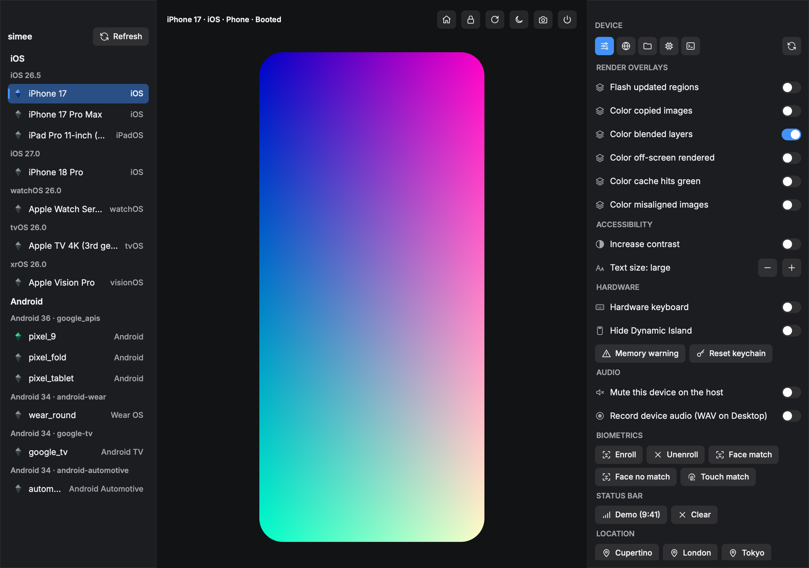

# Desktop window

One window for iOS and Android devices.



```bash
cd desktop
cargo run --release                     # SIMEE_DEVICE=<udid|name|booted> preselects a device
cargo run -- --snap shot.png --scene demo   # headless render; scenes: demo, android, foldable,
                                            # folded, tablet, ipad, watch, tv, apple-watch, apple-tv,
                                            # iphone-pro, pixel-pro, watch-ultra, empty, resources
cargo run --release --features tooling -- --snap shot.png --scene demo   # the same, optimized
```

`scripts/desktop-app.sh` builds the window as `simee.app`, a macOS bundle with simee's icon, so
the Dock and Finder show the mark. The mark in the window ([brand.md](design/brand.md)) is the
activity indicator: it turns beside a running job and on the empty stage while a device boots, and
each device in the list shows its state with it.

The window, the 3D device view included, draws with Rune's native Metal backend.
`SIMEE_GPU_BACKEND=wgpu` switches it to wgpu's Metal backend, and `metal` chooses the default. The
window looks and behaves the same on both, but wgpu costs a little more:
[benchmarks.md](benchmarks.md#desktop-runes-native-metal-backend-against-wgpu) and the
[3D view's costs](#3d-device-view) below. Rune's own `RUNE_GPU_BACKEND` overrides it.

## 3D device view

⌘3 switches the screen to a 3D view: the device's body (`sim_core::body`: phones, tablets,
foldables, watches, TVs, car head units and XR headsets and glasses) in perspective, with its live
screen on the screen face. It is drawn with a depth buffer and 4x MSAA. `SIMEE_VIEW=3d` starts the window with it on. It draws on both
backends: Rune's native Metal backend, the default, has had depth attachments and MSAA resolves
since anomalyco/rune#2563 (#193), and wgpu's (`SIMEE_GPU_BACKEND=wgpu`) remains an option.
Headless renders of every scene with a body in the 3/4, front, side, back and face-on views, and
flat, are byte-identical on the two backends. Under live Rust editing (the `hot` feature) there is no
compositor, so ⌘3 says it is unavailable there. With the 3D view off, the window is exactly the flat one:
screenshots are byte-identical to the build without it on both backends.

### What a body looks like

A body is drawn as the hardware is built (#590). Each row of the body table carries the maker's
published size, display diagonal and density, so the bezel is whatever those leave: 2.65 mm from
the edge of an iPhone 17 Pro to its screen, 3.5 mm on a Pixel 9, of which the band's rounded edge
takes 1.4 to 1.5 mm and the rest is black under the cover glass. Corners are continuous (a
superellipse that reaches 1.42 times a circular corner's radius and reads as that circle), not
arcs. The table has rows for the iPhone 17 and 16 lines, the iPhone Air, 16e and SE; the Pixel 9,
9 Pro, 9 Pro XL, 8 and 8 Pro (an AVD made for one of those hardware definitions gets its row);
the iPads and the Pixel Tablet; the Pixel Fold, Surface Duo and iPhone Duo; Apple Watch Series 10
and 11, Ultra 2 and 3, and SE; and the SDK's Wear OS, TV, automotive and XR profiles. A device
with no row gets a generic body round its own screen, built the same way. What nobody publishes
(corner radii, the band's edge, camera housings and lens sizes, key positions) is estimated, and
each row's source note says so. No row carries a logo or a vendor asset.

| Part | Drawn as |
| --- | --- |
| Front | One sheet of cover glass over the screen and the black border round it, flat on a phone and curving down to the band on a watch |
| Band | Anodized aluminium, polished metal or brushed titanium, per row, with its edges rounded over |
| Back | Glossy glass, matte glass, aluminium or ceramic, per row, in a colour close to one the maker sells |
| Keys | Pills of the band's metal standing 0.35 to 0.4 mm proud of a dark recess cut where the band's outline is; the iPhone's Camera Control lies flush |
| Cameras | The Pixel's bar under one cover glass, the iPhone 17 Pro's plateau, the islands and pills of the others, each with its lenses, flash and sensor windows; the Dynamic Island and a Pixel's punch hole on the screen |
| Watch | Crown on a recessed collar, side button, back crystal, lugs and a band that drapes behind the case; the Ultra's flat crystal, crown guard and Action button |

Shading is metallic/roughness against an analytic studio fixed to the camera: a key box up and to
the left, a strip behind and to the right that rims the far edges, a panel overhead, a slanted
card low on each side and a small window behind the camera, over a room that darkens toward the
floor. Every surface mirrors that studio by its roughness and Fresnel term, and a matte one also
gathers it diffusely; highlights roll off instead of clipping. The body stands on a floor that
shows only its contact shadow. Shading is in linear light into an sRGB target.

The screen's pixels are never lit: the shader writes the device's own colour and adds what the
cover glass mirrors, at 45% of what the black border beside it shows and never more than 9% of
full white. Face on (⌘0) that reflection is off, so the screen is the flat view's, pixel for
pixel.

It starts in a 3/4 view from the right and above. `SIMEE_SCENE_CAMERA` starts it in another
saved view: `front`, `side` (edge on: thickness, keys, camera bump), `back` or `face`.

You move the camera with the pointer (#155):

| Input | Does |
|---|---|
| Drag beside the device (anywhere the pointer is an open hand) | Orbit: the body turns with the pointer; the tilt stops 80° above or below |
| ⇧-drag, or a two-finger trackpad drag | Pan: the body follows the fingers, up to half the stage off centre |
| Mouse wheel, ⌘-scroll, or pinch | Zoom, up to 4x in or out, though never so close that the camera enters the body |
| Two-finger trackpad rotation | Spins the device with the fingers (from the front or from behind), settling on the nearest quarter turn |
| ⌘0, or the toolbar's Face on | Face on: the screen at 1:1, exactly where the flat view draws it, with the device turned back upright and to the front |
| ⌘1, ⌘2, ⌘4, ⌘5 | Saved views: 3/4, front, side, back (⌘3 is the toggle) |
| ⌘F, or the toolbar's Flip | Turns the device over to its back, and again to its front |
| ⌘[ / ⌘] | Turns the device a quarter counter-clockwise / clockwise as seen on screen, from any side. This is the body only: the toolbar's Rotate still turns the guest |

A drag that starts on the drawn screen belongs to the device. Touches through the projection
come with #156; until then such a drag only says so in the status line. Hold ⌥ to orbit from
there anyway. The pointer shows which is which: an open hand where a drag moves the camera
(a closed one while it does), the arrow over the screen. Keys still go to the device: the view
keys above are ⌘ shortcuts the device doesn't use.

Face on is the "2D" view of #253. The fitted views frame the whole body. Face on frames the
live screen at one backdrop pixel per window pixel instead, at any window size: in the demo
scene its screen is pixel-identical to the flat view's. Every change (a key, a button, the end of
a rotation) moves through one eased, interruptible transition of about 250 ms (`scene::Motion`,
read at the window's clock). The camera, the flip and the spin are separate tracks, so a spin
during a flip leaves the flip to land. A new change sets off from wherever the last one on its
track had reached, and a drag stops the camera there; scroll momentum carries on only a scroll
nothing has taken over from. Scripted timelines (#254) reuse it, with `Motion::go_with` to pick
each step's easing. Nothing redraws while nothing moves: `poll` asks for frames only while a transition runs,
plus one to land it. This view moves one device; arranging several in one scene is #155's part 3.

When a screen is on the back of the device (a folded book's cover screen), every view looks at
the back. A turned device rolls the body with its panel, so the screen reads as the flat view
shows it. A foldable lies flat while it streams its inner screen. When it streams its cover
screen, emu has folded it, so the body is shown shut. The desktop doesn't know a half-open
angle (#154). The toolbar, the keyboard and the panel work as usual, and clicking the 3D view
keeps the keyboard on the device. Turning the 3D view off frees its render targets, and the
camera is where you left it when it comes back on.

The live screen on the body is the flat view's own picture, with no CPU copy. The flat screen
stays laid out under an effect slot that asks Rune for a backdrop copy, and the compositor
samples the screen's rect of that copy. That costs one GPU texture copy of the window per drawn
frame. Rune can't yet hand a compositor a `NativeSurface`'s texture (anomalyco/rune#2546,
#192). The window draws only when something changes, so a still 3D view costs nothing.

What the 3D view costs on each backend, against the flat view (M3 Max, macOS 26.6.2, Rune
`e08594c`, 2026-11-27; headless, `--frames 300 --out <dir>`, median of 3 runs of each in a
rotating order, a build with `--features tooling,rune/frame-profile`, 1-minute load average 7 to
11). CPU is Rune's per-frame CPU; GPU is the process's `accumulatedGPUTime` per frame and includes
the frame's readback to the output PNG:

| | Metal flat | Metal 3D | wgpu flat | wgpu 3D |
| --- | --- | --- | --- | --- |
| iPhone 17 scene: frame CPU p50 / p95 | 0.19 / 0.24 ms | 0.27 / 0.32 ms | 0.22 / 0.29 ms | 0.42 / 0.50 ms |
| iPhone 17 scene: encode and submit | 0.09 ms | 0.17 ms | 0.13 ms | 0.31 ms |
| iPhone 17 scene: GPU per frame | 1.73 ms | 1.99 ms | 1.71 ms | 1.95 ms |
| Pixel Fold scene: frame CPU p50 / p95 | 0.18 / 0.23 ms | 0.26 / 0.32 ms | 0.24 / 0.28 ms | 0.44 / 0.58 ms |
| Pixel Fold scene: encode and submit | 0.09 ms | 0.17 ms | 0.14 ms | 0.35 ms |
| Pixel Fold scene: GPU per frame | 1.50 ms | 1.76 ms | 1.44 ms | 1.62 ms |

On native Metal the 3D view costs about 0.08 ms more CPU a frame than the flat view, against
0.2 ms on wgpu, and 3D on Metal takes 0.15 to 0.18 ms less CPU a frame than 3D on wgpu. GPU time is
the same on both within the runs' spread (about ±0.2 ms). That is why native Metal is the 3D
view's default. The live rows below were taken on wgpu before native Metal could draw the scene
(#260). They have not been taken again on Metal: a live run needs a window that stays visible on
an idle desktop.

The glass and metal shading, the floor and the finer meshes (#590) were measured the same way on
2026-11-28 against the build before them, the two builds in turn in one session (Rune `e08594c`,
1-minute load average 13 to 14, so the absolute numbers are not comparable with the table above):

| 3D view | Metal before | Metal after | wgpu before | wgpu after |
| --- | --- | --- | --- | --- |
| iPhone 17 scene: frame CPU p50 / p95 | 0.34 / 0.49 ms | 0.35 / 0.54 ms | 0.50 / 0.65 ms | 0.59 / 0.96 ms |
| iPhone 17 scene: encode and submit | 0.20 ms | 0.21 ms | 0.36 ms | 0.43 ms |
| iPhone 17 scene: GPU per frame | 1.46 ms | 1.65 ms | 1.90 ms | 1.92 ms |
| Pixel Fold scene: frame CPU p50 / p95 | 0.30 / 0.40 ms | 0.31 / 0.50 ms | 0.48 / 0.66 ms | 0.51 / 0.76 ms |
| Pixel Fold scene: encode and submit | 0.18 ms | 0.19 ms | 0.36 ms | 0.38 ms |
| Pixel Fold scene: GPU per frame | 1.52 ms | 1.51 ms | 1.78 ms | 1.71 ms |

On native Metal a 3D frame costs about 0.01 ms more CPU than before, and the iPhone scene 0.19 ms
more GPU; the Pixel Fold scene's GPU time and both scenes' on wgpu moved less than the runs'
spread. The flat view is unchanged (it draws none of this). A body is now a draw for each
material part (the glass, the band, the back, every key and its recess, every lens) where it was
one for the whole shell, and its bounds are taken from each vertex once.

What the 3D view costs, against the flat view on the same wgpu backend (Rune `f6f6e04`, #260):

| | flat | 3D |
| --- | --- | --- |
| Headless, iPhone 17 scene (`--frames 300`, median of 3): frame CPU p50 | 0.25 ms | 0.43 ms |
| Headless, iPhone 17 scene: encode and submit | 0.16 ms | 0.32 ms |
| Headless, iPhone 17 scene: GPU per frame (includes the frame readback) | 1.56 ms | 1.81 ms |
| Headless, Pixel Fold scene: frame CPU p50 / GPU per frame | 0.22 / 1.59 ms | 0.40 / 1.90 ms |
| Live iPhone 17 Pro, iOS 26.5, 20 s of swipes (one run each): CPU / GPU, % of a core | 6.0 / 5.5 | 8.3 / 6.3 |
| Live, same run: frames drawn, frame time p50 / p95 | 775, 0.54 / 0.62 ms | 786, 0.79 / 0.94 ms |
| Live, idle 20 s: CPU / GPU % | 1.25 / 0.65 | 1.40 / 0.68 |

The live rows are a single run each, taken as #215 took them (`--window-script`, `RUNE_FRAME_LOG`,
the AGX client's GPU time). A second run of each stopped drawing because its window was covered
on a desktop in use (Rune draws nothing while a window is occluded), so there is no median yet.
The headless rows render offscreen and don't depend on window visibility.

Rune's headless flags (`--snap`, `--tree`, `--script`, `--video`) are always in debug builds; a
release build has them only with the `tooling` feature. The shipped release build leaves it off:
it adds 1,338,496 B to the stripped binary (32,950,904 → 34,289,400 B, Linux x86_64, 2026-11-26)
and no measurable startup time.

Devices are listed under iOS and Android, each with its sub-platform. Pick one (boot it if
needed): click and drag on the screen for touches; type to use the device keyboard. ⌘⇧H is Home,
⌘L Lock/Power, ⌘S saves a screenshot to the Desktop, ⌘3 switches the [3D view](#3d-device-view)
on and off, and while it shows, ⌘0, ⌘1, ⌘2, ⌘4, ⌘5, ⌘F and ⌘[ ⌘] move it. The toolbar follows the form factor:

| Device | Controls |
| --- | --- |
| iPhone / iPad | Home, Lock, Rotate, Appearance |
| Apple Watch | Crown press, Side button, Crown up / down |
| Apple TV | Menu, TV, arrows and Select (the Siri Remote), Appearance |
| Apple Vision Pro | Home, Appearance |
| Android phone | Back, Home, Recents, Power, Rotate |
| Android tablet | the above, plus Stylus (the pointer becomes a pen: moving over the screen hovers, dragging draws) |
| Android foldable | the above, plus Fold / Half open / Unfold (folded, the view takes the outer screen's shape) |
| Wear OS watch (round screen) | Back, Home, Power, Rotary up / down |
| Android TV | Back, Home, Power, D-pad and Select |
| Android Automotive | Back, Home |
| Android XR | Back, Home, Power, Look left / Recenter / Look right |

iOS frames go to the GPU without copying (the framebuffer IOSurface is sampled directly) and the
right-hand panel has five debug tabs (Device, Network, Storage, Processes, Logs). Android frames
stream from the emulator's display socket, and the panel shows the device and its live guest
console.

## Device list

Booted devices come first, under a "Booted" header above the platform and runtime groups.
Devices that are booting are listed there too, whether the service says so or a boot started
from this window is still running (`desktop/src/list.rs`, #565).

The search field at the top of the list filters it fuzzily. ⌘K focuses it from anywhere, and ⌘F
does too while the list has focus (elsewhere ⌘F flips the 3D view). It matches on the name,
device type, runtime, platform, sub-platform, form factor, and the AVD name or UDID. Letters may
be scattered: "pix9" finds `acceptance-pixel-9`, and "17 26.5" finds the iPhone 17s on iOS 26.5.
Every word of the query has to match. A UDID matches only as a run of its characters. The
scoring is in `sim_core::fuzzy`. While you type, the groups collapse to the matches, booted
ones first and then the best matches. ↑ and ↓ move through them, Return acts on the
highlighted one as a click would (⌥Return selects only), and Escape clears the query. Escape
again leaves the field. The highlight belongs to a device, the first match as it is first
shown until an arrow moves it, so a rescan that lists a better match (a farm's new AVD) before
Return doesn't change what Return boots.

One click on a shut-down device, or Return on its row, selects it and boots it. The boot goes
through [admission](#admission-before-a-boot) as the Boot button's does. ⌥-click selects
without booting. Boot on a device that is already booting (started elsewhere) says so on the
status line. Rows are keyed `device-row:<udid or AVD name>` (their parts `device-mark:`,
`device-bar:`, `device-platform:`, `device-popped:`), so no AVD name gives a row a fixed key.

Boots and other long jobs (shutting down, a Duo fold, CarPlay) belong to their device
(`desktop/src/jobs.rs`, #558). The stage's "Waiting for the device to finish booting…" and the
indicator at the top right show only the selected device's job, and each row's mark turns
while its device has one. Work for the whole window ("Refreshing…") and a count of the other
devices' jobs ("1 device booting") are shown beside Refresh. Two boots at once each finish, and
each reports its own failure, named by its device. A device runs one job at a time: a second
waits, and the status line says so.

The headless scenes `list-booted` (a device booting from here, selected, at the top) and
`list-search` ("17 26.5" typed, the second match highlighted) show the list.

## Panes and settings

The device list (left) and the panel (right) each have a drag handle on their inner edge:
drag it to resize (180–420 points for the list, 280–600 for the panel, always leaving the
screen at least 420), double-click it for the default width. To hide and show them:

- the stage toolbar's sidebar buttons: the list's leads the toolbar and stays at the window's
  left edge while the list is hidden, the panel's ends it;
- the View menu on macOS: Show/Hide Device List (⌘⌥S), Show/Hide Panel (⌘⌥I) and Resources
  (⌘⌥R, the [resource panel](#resource-panel));
- the shortcuts alone, ⌘⌥S, ⌘⌥I and ⌘⌥R, on every platform.

A pane changes only on one of those (#559, #560, #561). A rescan, a selection, a boot finishing,
an admission check or popping a device out or back in leaves both panes and the panel's mode as
they are; with no device on screen the panel stays and says so. A pop-out window has no panes of
its own: its menu bar holds its own items, so ⌘⌥S, ⌘⌥I and ⌘⌥R pressed there change nothing in
the main window. A window too narrow for the panes beside the screen's 420 points first draws
them narrower (down to their minimums, saving nothing), then collapses the panel, then the
list, with a note on the stage, and brings each back once there's room again. A pane hidden by
hand stays hidden.

Each change goes to stderr with its cause, for example `simee-desktop: panes: panel hidden
(key)`; the causes are `key`, `button`, `menu`, `restore` (from the settings file at start),
`narrow`, `room` and `admission` (the admission sheet's "Why?"). The headless scenes
`sidebar-hidden`, `inspector-hidden`, `panes-hidden`, `panes-wide`, `toggled-list`,
`toggled-panel` and `panel-empty` show them; `--size 800x870` with any of them shows a
collapsed panel.

The window keeps its layout in a small versioned JSON file (`desktop/src/settings.rs`):
`~/Library/Application Support/simee/desktop.json` on macOS, `$XDG_CONFIG_HOME/simee/` (or
`~/.config/simee/`) on Linux, `%APPDATA%\simee\` on Windows; `SIMEE_DESKTOP_SETTINGS` names
another file. It holds the panes' widths and visibility, the last selected device and debug tab,
the window's size and position, the screenshot folder (`screenshot_dir`; the Desktop when unset
or missing), and the device list's collapsed groups, hidden devices and tools, order and
favorites for the organization work that follows. It is read at start and written half a second
after changes stop, and again as the window closes, through a temporary file renamed over it.
A file that can't be read, isn't valid, or comes from a newer version falls back to the
defaults with one line in the status bar. It is copied aside first
(`desktop.json.<why>-<secs>.bak`) and never deleted; if even the copy fails, nothing is saved
that session. Headless runs never read or write it. The window names the file it uses on
stderr as it starts (`simee-desktop: settings: <path>`).

## Resource panel

⌘⌥R, View > Resources, or the gauge button in the panel's top-right corner swaps the panel for
the resource panel (`desktop/src/resources.rs`, #276), and shows the panel first if it was
hidden; again, it swaps the platform panel back. Nothing else changes it. It shows what the
host has left and what each running device costs. Host gauges come from the API's `host`: busy
CPU, load per core, memory pressure and free memory, swap, free disk, the thermal state and the
admit / hold / backoff verdict. The device list comes from `devices_usage`: CPU, memory, disk I/O
and (where the host reports it) energy per device, sorted by CPU or memory, with a sparkline of the
last minute. Each device the window lists has quick actions: show it in the window, stop its
stream (when one runs through the stream API in this window's process), and shut it down. The
device on screen shuts down as the toolbar's button does; any other device goes through the API's
`shutdown`, and the gauges and the device list follow at once. A device the window doesn't list
(a stock emulator started without an AVD) has no actions.

The panel samples at most once a second, on a thread of its own, and only while it shows: with
the panel, the inspector or the window hidden it asks for nothing and schedules no wake. A sample
that changes nothing shown draws no frame. Its visibility and sort persist in the settings file
(`resources`). The headless scenes `resources` and `resources-memory` show it with fixed data.

## Admission before a boot

Before the window boots a device it asks the API's `admission_check` (the device's platform,
form factor and count; see [Admission](api.md#admission)) whether the host can take it
(`desktop/src/admission.rs`, #275), on a thread of its own so the window never waits. On admit
the device boots with no UI. On hold or backoff a sheet drops from the top of the window with
the numbers ("Booting pixel_tablet would take memory used from 78% to 89%") and every reason
the API gave, and offers Boot anyway, Boot N (when the host admits some of the devices asked
for but not all: the first N, from `predicted.admissible`) and Cancel (or Escape). Boot N is
the default button when offered, otherwise Cancel. "Why? See the resource panel" shows the
[resource panel](#resource-panel) beside the sheet, with the host's verdict now. "Don't ask
again for Android phone devices this session" skips the check for that platform and form
factor on the next boots, until the window quits; it is remembered only when the sheet boots,
not when it is cancelled. A check never blocks silently: one that fails or can't start boots
anyway and says so in the status bar. The window boots one device at a time (the toolbar's
Boot), so Boot N shows only for a request of several devices; it creates and clones no devices
yet. The headless scenes `admission` and `admission-many` show the sheet with fixed data.

## Screenshot preview

⌘S, or the toolbar's Screenshot button, saves the device's screen to the Desktop as a PNG, as
before, on iOS and Android alike. ⌘S works wherever the focus is in the window. A thumbnail of
the shot then slides up into the window's bottom-right corner, as the macOS screenshot preview
does (`desktop/src/shot_preview.rs`):

| Do | What happens |
| --- | --- |
| Nothing | It stays 5 s, then slides off to the right. The file stays saved |
| Hover over it | It stays while the pointer is there, and for at least 1.5 s after |
| Take more shots | They stack leftwards, newest in the corner, up to four. A fifth sends the oldest away |
| Drag it into Finder, Mail, Slack, a browser upload… | It drops as the PNG file. The drag carries the file and the PNG data (Rune's `drag_out`). A drop the other app accepts dismisses the preview |
| Click it | Opens the file in its default app (Preview) |
| Right-click it | Open, Copy (the PNG to the pasteboard), Show in Finder, Delete (removes the file) |
| Swipe right on it with two fingers | Dismisses it early |

Under the system's reduced motion it appears and leaves without sliding. The window asks for
frames only while a preview moves, plus one wake when the next one is due to leave. The
`screenshot` and `android-screenshot` headless scenes show it settled.

## Pop-out windows

Any running device can leave the main window for a native window of its own, sized to its
screen, and come back (`desktop/src/popout.rs`, #286). Pop it out from its row's context menu in
the device list (Pop Out to Window), the stage toolbar's pop-out button, or ⌘⇧O; the main window
then shows the next running device, and the list marks the one that's out. Several devices can
be out at once. Pop back in from the pop-out's toolbar, ⌘⇧O in it, the row's menu (Pop Back In),
or by closing the window: closing returns the device to the main window as its selected device,
it never shuts the device down. Selecting a device that's out focuses its window. Closing the main
window ends the app, pop-outs included.

The device's connection moves with it rather than reconnecting: an iOS device's capture thread
and HID session (the zero-copy surface keeps its latest frame and wakes the window now drawing
it), an Android device's display stream and console worker. The pop-out's first frame is the one
the main window last showed, and it keeps drawing while the main window is hidden. Each window
owns the device it shows, so its touches and keys can only reach that device. A pop-out has the
device's toolbar (the form factor's controls, without the tablet stylus) and ⌘S; its console
results and errors show on its own status line. It is flat: the 3D device view stays in the main
window.

A popped device that stops, shut down from the resource panel, the CLI or a script, or an
emulator that went away, lets go of its connection at once: the pop-out says the device stopped
and keeps only Pop Back In, and the device comes back to the main window as one that isn't
running, never with its last frame. A pop-out asked for on a device that isn't connected yet (a
row's menu on a device that wasn't selected) waits up to 10 seconds for it, then gives up and
says so, so a later scan never pops it out unasked.

Each device's pop-out frame is kept in the settings file (`popouts`, by UDID or AVD name), so
popping the same device out again, in this run or the next, opens it where it was. A frame saved
on a display that's no longer connected opens on the nearest one that is, whole where it fits,
as the main window's restore checks its own frame. Reopening the
pop-outs that were open at quit is #288. The windows open at run time through Rune's
`open_window`, which headless runs don't do: the `popped` scene shows the main window with its
device out, and the pop-out's own view is checked in the tests.

